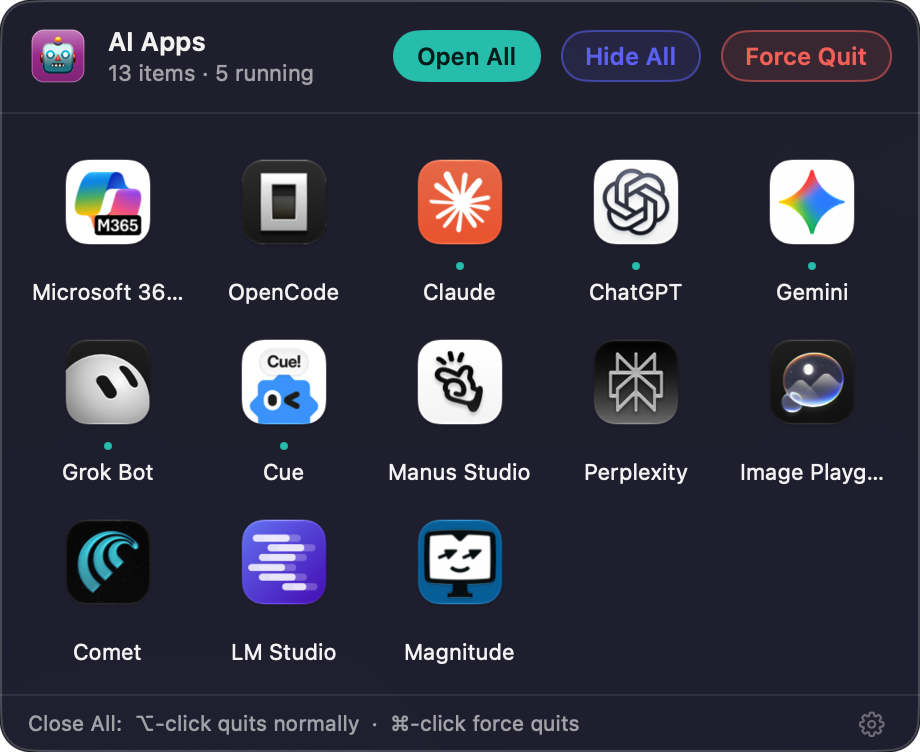
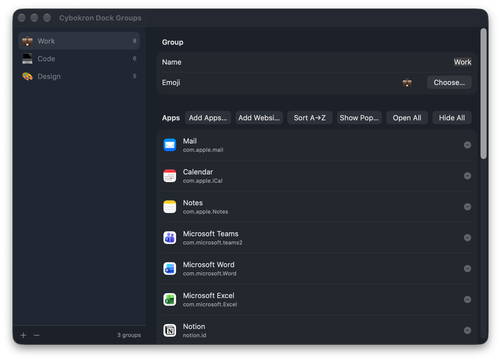
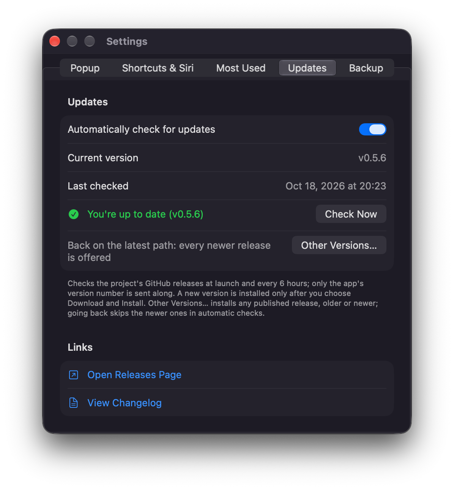
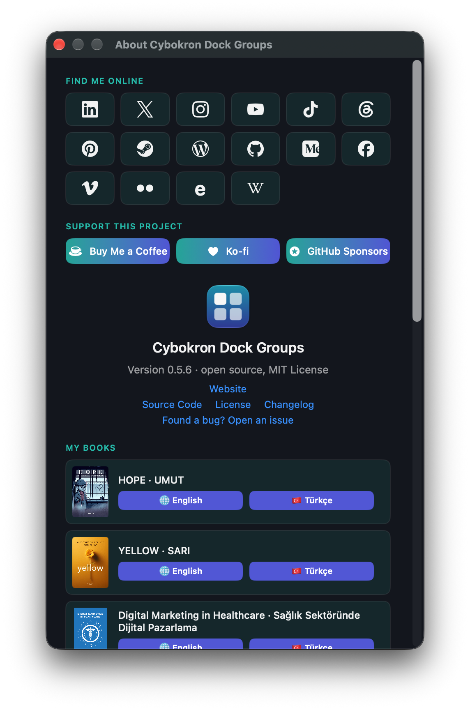

# Cybokron Dock Groups

A free, open-source macOS menu bar utility that organizes your apps into named groups. Choose a
group from the menu bar to see its apps in a popup over the Dock, or open them all at once.

> Status: early development (phase E — standalone Dock icons).

## Screenshots

<table>
  <tr>
    <td align="center"><br><sub>Group popup over the Dock</sub></td>
    <td align="center"><br><sub>Group management window</sub></td>
  </tr>
  <tr>
    <td align="center"><br><sub>Settings</sub></td>
    <td align="center"><br><sub>About</sub></td>
  </tr>
</table>

## Features (so far)

- Menu bar item listing your groups with their tiles. Choosing a group shows its **popup**; holding
  ⌥ while choosing opens all of its apps right away.
- Group popup: a floating panel over the Dock (it doesn't take focus from the app you're using)
  with the group's app icons in a grid and a running indicator per app. Click an app to open it or
  bring it to the front; **Open All** opens every app; **Close All** quits the group's running apps
  normally, ⌘-click force quits them. Escape, a click elsewhere, or switching apps closes it.
- In the popup, drag an app to another place to reorder the group, or drag it out of the popup to
  remove it from the group (the app itself isn't touched). The new order is saved right away.
- Global keyboard shortcuts: ⌃⌥1 shows the first group's popup, ⌃⌥2 the second, and so on up to
  9; pressing it again closes the popup. The modifier keys can be changed, or the shortcuts turned
  off, in Settings → Shortcuts. To notice them while you work in other apps, the app needs
  Accessibility access (Privacy & Security → Accessibility); it asks once. The shortcuts are
  observed, not taken over, so the app in front also receives the key press.
- Siri, Spotlight and the Shortcuts app: **Launch Group** (Open All), **Quit Group** (Close All,
  optionally force quit) and **Show Group** (the popup) actions, and phrases such as “Launch Work in
  Cybokron Dock Groups”. Groups are matched by ID, so shortcuts survive renames.
- Links, e.g. from scripts or other apps (`open "cybokrondockgroups://open/work"`):

  | Link | Does |
  | --- | --- |
  | `cybokrondockgroups://open/<group>` | Shows the group's popup |
  | `cybokrondockgroups://launch/<group>` | Open All |
  | `cybokrondockgroups://quit/<group>` | Close All; add `?mode=force` to force quit |
  | `cybokrondockgroups://shortcut/<1…9>` | Shows the popup of the group with that shortcut |
  | `cybokrondockgroups://close` · `settings` · `groups` | Closes the popup · opens Settings · the group window |

  `<group>` is the group's name — case, accents, spaces and punctuation don't matter
  (`Çalışma Alanı` → `calisma-alani`) — or its ID. The same link is ignored when it comes again
  within 5 seconds.
- **Open All** never launches a running app a second time: running apps are brought to the front.
- Group management window: add, rename, reorder and delete groups; add apps with an open panel,
  reorder or remove them. Deleting a group never touches the apps themselves.
- Group tiles drawn by the app: the group's emoji, or a 2×2 / 3×3 grid of its first app icons, on a
  solid, gradient or glass background in the color you pick. They appear in the menu, the popup
  header and a live preview in the group window.
- **Most Used**: the menu lists the apps you open most — from the Dock, Finder, Spotlight or a
  group — with no setup. Choose one to open it, or **Show Most Used** for a popup of them (read-only:
  apps open, but can't be reordered or removed). Apps are ranked by launch count; apps you open
  within the same session (10 minutes by default) get a small bonus of at most 30 %. Settings →
  Most Used turns the list off (launches are still counted), sets how many apps it shows (5, 10 or
  15) and the session length, and clears the history. Background agents and a few system
  processes (Finder, Spotlight, …) aren't counted.
- **Standalone Dock icons**: turn on *Standalone Dock icon* in a group's settings and the group gets
  its own small app, with the group's tile (emoji or app icon grid) as its icon, at the end of the
  Dock. Clicking it shows the group's popup over the Dock, clicking it again hides it, and ⌥-clicking
  it opens all of the group's apps right away — even while Cybokron Dock Groups isn't running. The
  popup opens apps, Open All and Close All as usual; apps are reordered and removed in the main app.
  - The group's app lives in `~/Library/Application Support/Cybokron/DockGroups/Agents/<name>.app`
    (`calisma-alani.app` for “Çalışma Alanı”). It's a copy of this app's own executable with its own
    Info.plist (bundle identifier `com.cybokron.dockgroups.agent.<group ID>`, no Dock icon of its own
    while running, no menu bar item, shortcuts, Siri actions or links), the group's settings in
    `Contents/Resources/group-config.json` and the icon as `AppIcon.icns` (16 to 1024 pixels). It's
    signed ad hoc with `codesign` and verified before it's moved into place; if signing fails, nothing
    is installed and the setting turns itself off again. It's then registered with LaunchServices
    (`lsregister -f`).
  - The tile is added to the Dock's app list (`persistent-apps` in the `com.apple.dock` preferences,
    as `defaults write` would) and the Dock restarts for a moment (`killall Dock`) to show it. Only
    tiles of the groups' apps are added, updated or removed; the rest of the Dock stays as it is.
  - Changes to the group (or to the popup settings it uses) rebuild its app shortly afterwards, and a
    running copy reloads them. Renaming the group moves the app to its new name and updates its tile.
    The Dock caches tile icons, so after an icon change the group's settings offer **Update Dock
    Icon**, which clears the Dock's icon cache and restarts the Dock.
  - Turning the setting off, deleting the group, or dragging the tile out of the Dock (noticed when
    the app starts or the group window opens) removes the group's app: a running copy is asked to quit
    (and forced after 3 seconds), its tile is removed and the Dock restarts. When the app starts it
    also removes group apps that belong to no standalone group (“stranded” ones, e.g. left by a
    crash) — unless they're running; those go once they've quit.
- Settings (⌘,): popup theme (dark by default, light, or matching the system), frosted glass,
  columns (auto or fixed), maximum rows (extra rows scroll), app names, position. Each group can
  override the layout settings in its own settings.
- **Updates** from the project's [GitHub releases](https://github.com/ercanatay/cybokron-dock-groups/releases):
  **Check for Updates…** in the menu bar menu shows a small window with the result. The app also
  checks shortly after launch and every 6 hours (Settings → Updates turns that off; only the app's
  version number is sent). A newer version is offered with its release notes; **Download and
  Install** downloads the universal DMG, checks its size and SHA-256 checksum, copies the app out of
  the read-only mounted image, moves the running app to `updates/backups/`, puts the new one in its
  place and relaunches — putting the previous one back if that fails. See [CHANGELOG.md](CHANGELOG.md).
- Everything stays on your Mac, in `~/Library/Application Support/Cybokron/DockGroups/`:
  `groups.json` for the groups, `preferences.json` for the settings, `usage-stats.json` /
  `usage-cooccurrence.json` for the launch counts behind Most Used, `Agents/` for the
  standalone groups' apps, and `update-state.json` / `updates/` for the updater (last check,
  skipped version, downloads and the previous version's backup).

The app has no Dock icon of its own (`LSUIElement`); standalone groups bring theirs. Opening it again while it runs (Finder, Spotlight,
`open -a "Cybokron Dock Groups"`) shows the popup of the group shown last (or the first group); if a
popup is already showing, or there are no groups yet, it shows the group window instead.

## Download

Get the universal disk image (`Cybokron-Dock-Groups-<version>-universal.dmg`) from the
[releases page](https://github.com/ercanatay/cybokron-dock-groups/releases), open it and drag the app
to Applications.

Releases from v0.5.2 on are **signed and notarized**: the app and the disk image are signed with the
Developer ID Application certificate of Developer ID (hardened runtime), and the
disk image is notarized by Apple with the ticket stapled to it. They open without a Gatekeeper
warning. To check a download:

```sh
spctl -a -t open --context context:primary-signature -vv Cybokron-Dock-Groups-<version>-universal.dmg
# → accepted, source=Notarized Developer ID
```

Because signed releases keep the same signature identity, Accessibility access carries over from one
signed release to the next. Coming from an ad hoc signed build (v0.5.0, v0.5.1 or your own build),
allow it once more in Privacy & Security → Accessibility.

### Opening v0.5.0 / v0.5.1 and your own builds the first time

These builds are signed ad hoc only, so macOS blocks the first open of a downloaded copy
(“Apple could not verify …”). Either:

- try to open the app once, then go to **System Settings → Privacy & Security**, choose
  **Open Anyway** next to the message about Cybokron Dock Groups and confirm; or
- remove the quarantine attribute in Terminal, from the disk image before opening it or from the
  copied app:

  ```sh
  xattr -dr com.apple.quarantine ~/Downloads/Cybokron-Dock-Groups-0.5.1-universal.dmg
  xattr -dr com.apple.quarantine "/Applications/Cybokron Dock Groups.app"
  ```

Apps you build yourself aren't quarantined and open directly.

## Requirements

- macOS 14 Sonoma or later (Apple silicon or Intel)
- To build: Xcode 16 or later, or just the Command Line Tools (see below)

## Building

### Xcode

The project is generated with [XcodeGen](https://github.com/yonaskolb/XcodeGen) from `project.yml`;
the generated `CybokronDockGroups.xcodeproj` is committed, so XcodeGen is only needed after changing
`project.yml` or adding/removing files (`brew install xcodegen && xcodegen generate`).

```sh
xcodebuild -project CybokronDockGroups.xcodeproj -scheme CybokronDockGroups -configuration Debug build
xcodebuild -project CybokronDockGroups.xcodeproj -scheme CybokronDockGroups test
```

Builds are signed ad hoc, so no developer account is needed. Release builds are universal
(arm64 + x86_64). Only the CI release job signs with the Developer ID certificate (see below).

### Command Line Tools only (SwiftPM)

```sh
scripts/test.sh                              # unit tests
scripts/build-app.sh debug                   # build/debug/Cybokron Dock Groups.app
UNIVERSAL=1 scripts/build-app.sh release     # universal release build
```

### Building a release DMG

```sh
scripts/make-dmg.sh   # build/release/Cybokron-Dock-Groups-<version>-universal.dmg
```

It builds the universal release app and packs it with an Applications shortcut into a compressed
disk image. By default the app is signed ad hoc and the DMG isn't signed. With `CODESIGN_IDENTITY`
set to the SHA-1 of a Developer ID Application identity in your keychain, `build-app.sh` signs the
app with it (`--options runtime --timestamp`) and `make-dmg.sh` signs the DMG too:

```sh
CODESIGN_IDENTITY=<SHA-1 from `security find-identity -v -p codesigning`> scripts/make-dmg.sh
```

For `v*` tags, CI does this with the Developer ID certificate from the repository secrets
(`APPLE_DEVID_CERT_P12`, `APPLE_DEVID_CERT_PASSWORD`) in a temporary keychain, notarizes the DMG with
`notarytool` and an App Store Connect API key (`APPLE_ASC_KEY_P8`, `APPLE_ASC_KEY_ID`,
`APPLE_ASC_ISSUER_ID`), staples and verifies it (team `APPLE_TEAM_ID`), and attaches it to a draft
release.

With Xcode installed, `build-app.sh` also extracts the App Intents metadata
(`Contents/Resources/Metadata.appintents`) that Siri and the Shortcuts app read, as Xcode does;
builds made with the Command Line Tools alone work but don't offer the Shortcuts actions.

Ad hoc signed builds get a new signature every time they're built, so macOS treats each build as a
new app for Accessibility access: after rebuilding, remove the app from the Accessibility list and
allow it again for the global shortcuts to work in other apps.

Every new build of the app has a different executable, so at its next start the standalone groups'
apps are rebuilt from it. Debug builds made with Xcode keep their code in the one executable too
(`ENABLE_DEBUG_DYLIB = NO`), because that executable is what the group apps copy. To try the
signing failure path, start the app with `CYBOKRON_SIMULATE_SIGN_FAILURE=1` set.

To try the updater without GitHub, serve a release JSON (shaped like GitHub's
`/releases/latest` answer) locally and point the app at it; `CYBOKRON_UPDATE_DRY_RUN=1` stops an
installation once the new app is downloaded, checked and staged, without replacing anything:

```sh
python3 -m http.server 8765 --bind 127.0.0.1 &   # serves ./latest.json and the DMG
open --env CYBOKRON_UPDATE_FEED_URL=http://127.0.0.1:8765/latest.json \
     --env CYBOKRON_UPDATE_DRY_RUN=1 "build/debug/Cybokron Dock Groups.app"
```

The scripts work around two Command Line Tools limitations automatically: they pick a macOS SDK
whose SwiftUI doesn't need Xcode's macro plugins, and they point the compiler at swift-testing's
macro plugin. If SwiftPM reports `disk I/O error` for its build database (seen with checkouts in
synced folders such as `~/Documents`), build elsewhere:
`SWIFTPM_SCRATCH_PATH=~/Library/Caches/CybokronDockGroups scripts/build-app.sh`.

## Project layout

| Path | Contents |
| --- | --- |
| `Sources/DockGroupsCore` | Group model and preferences, JSON persistence, stores, Open All / Close All, popup layout, placement and drag geometry, tile renderer and cache, shortcut digits, URL commands and group lookup, standalone group apps (bundle layout and config, icon, installer, Dock tile list, sync and cleanup decisions), updates (release parsing, version comparison, asset choice, download, install and rollback) (no UI) |
| `Sources/CybokronDockGroups` | App: AppKit lifecycle, menu bar item, popup panel, global shortcut monitor, App Intents, SwiftUI group, settings and About windows, standalone group apps (`Standalone/` keeps them in sync, `Agent/` runs a group's own app), updater and its window (`Updates/`) |
| `Tests/DockGroupsCoreTests` | swift-testing unit tests for the core |
| `Resources` | `Info.plist`, asset catalog with the placeholder app icon |
| `scripts` | SwiftPM build/test scripts, App Intents protocol list for the build, icon generator |

The placeholder app icon is drawn by `scripts/generate-app-icon.swift` from plain shapes.

## License

MIT — see [LICENSE](LICENSE).
