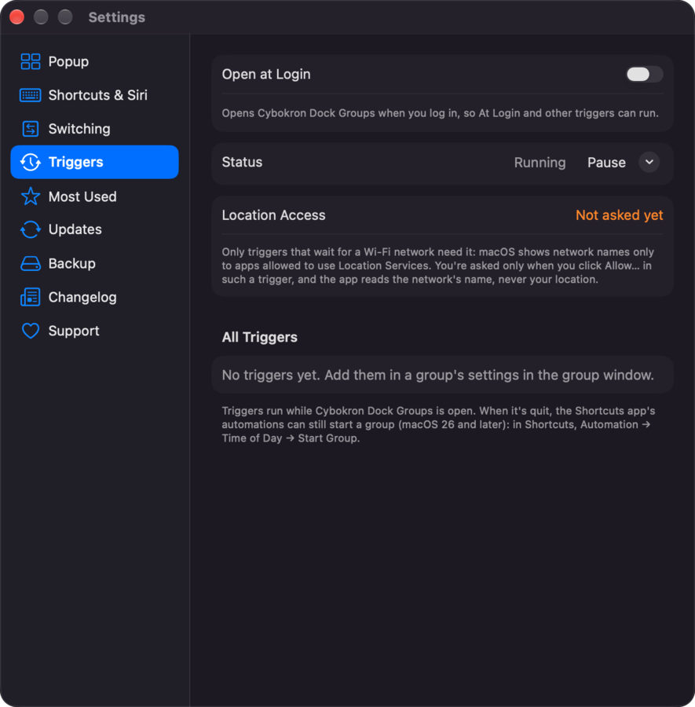
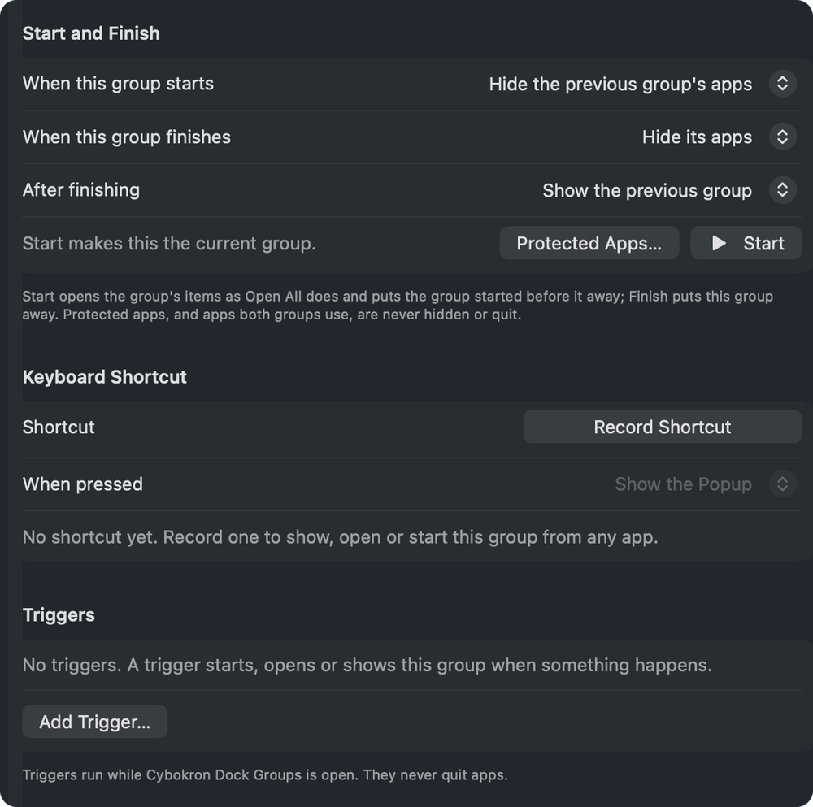
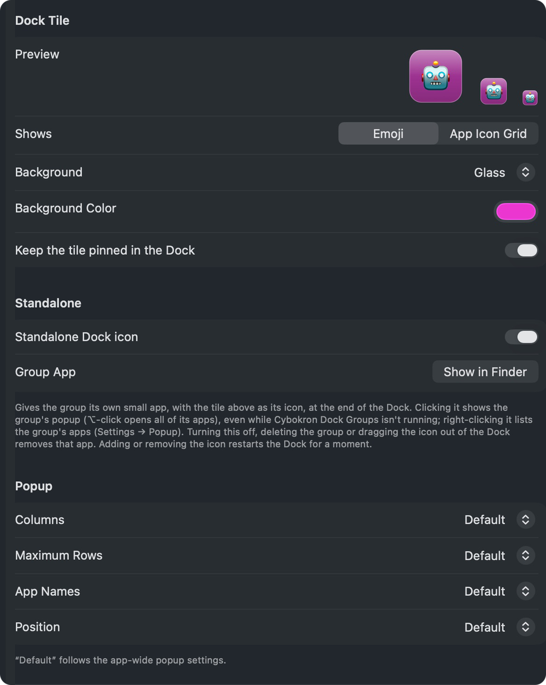
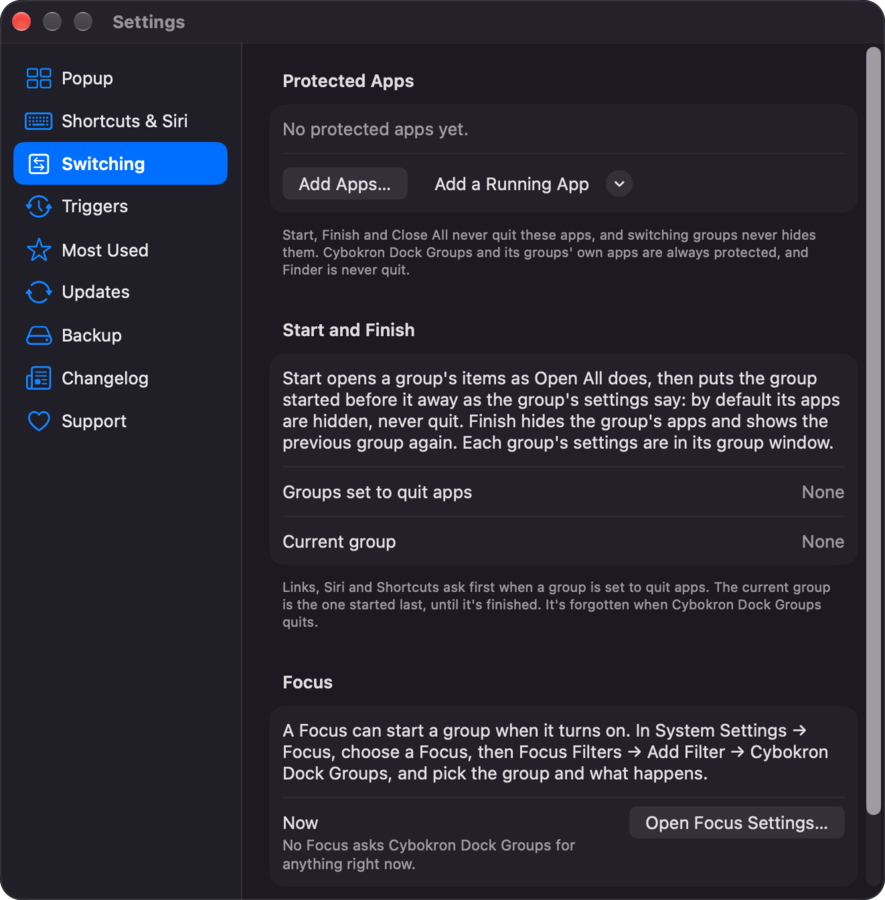
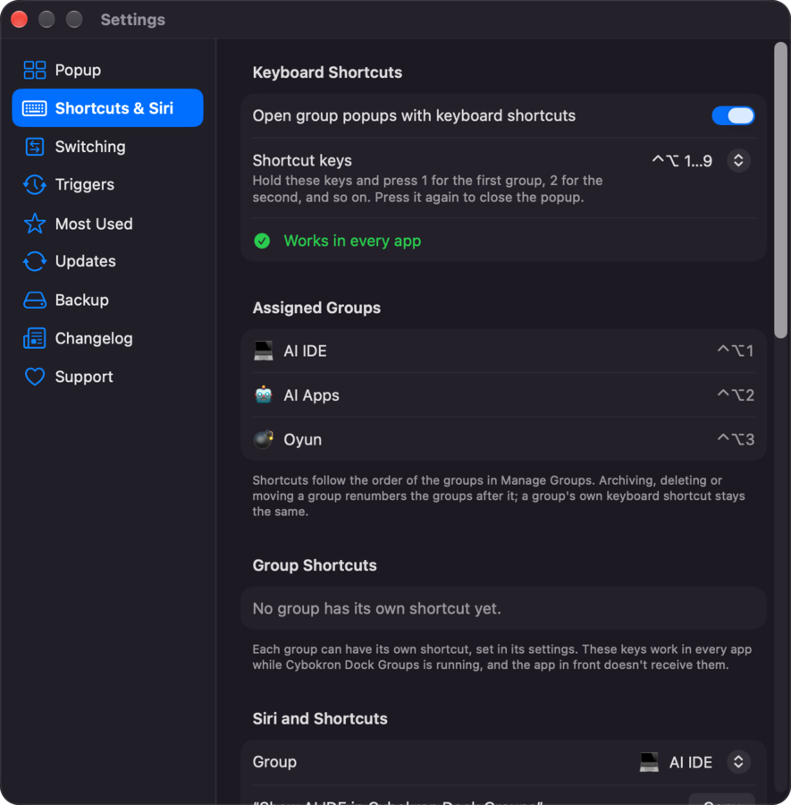
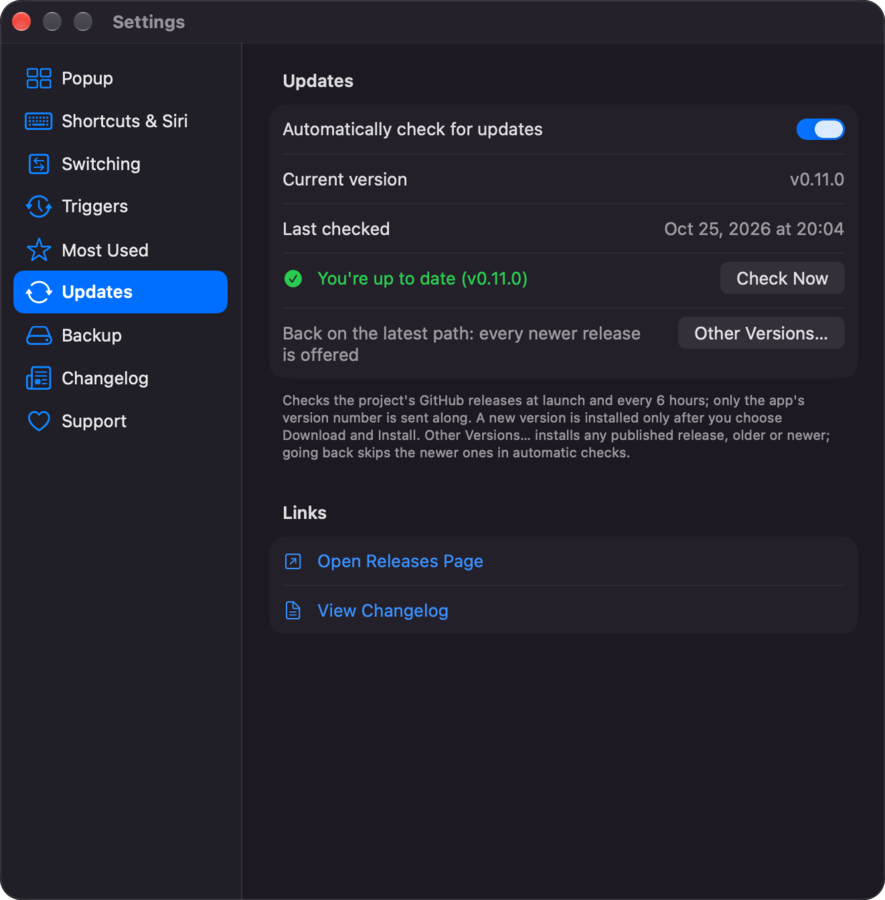
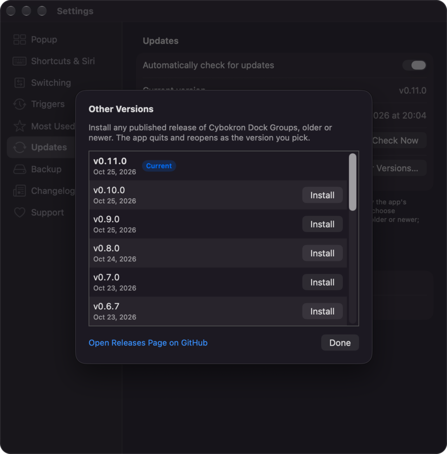
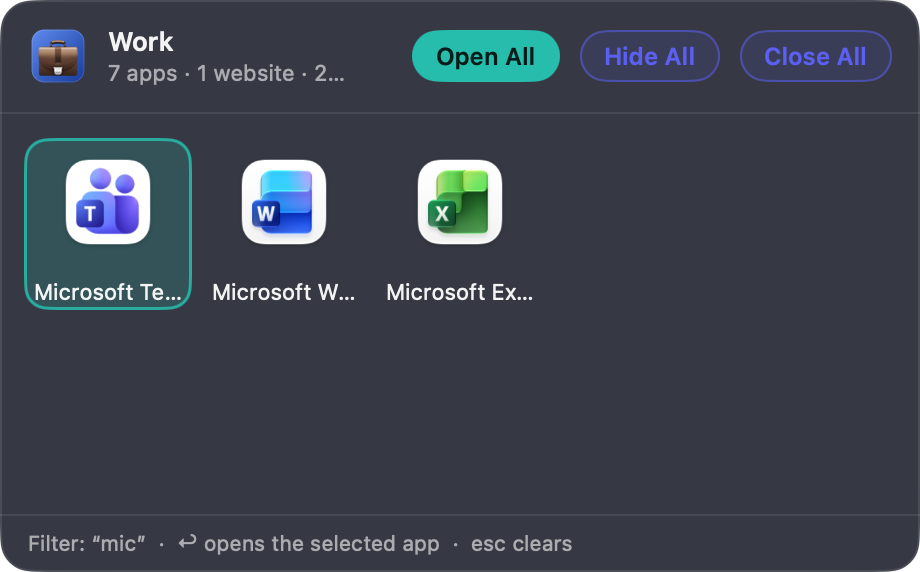

# Cybokron Dock Groups

A free, open-source macOS menu bar utility that organizes your apps into named groups. Choose a
group from the menu bar to see its apps in a popup over the Dock, or open them all at once.

> Status: in active development — current release v0.6.3 (Developer ID signed and notarized), with 26 languages.

## Screenshots

<table>
  <tr>
    <td align="center" colspan="2"><br><sub>Group window: your groups, their items and quick actions</sub></td>
  </tr>
  <tr>
    <td align="center"><br><sub>The popup: open, hide or quit a whole group</sub></td>
    <td align="center"><br><sub>Settings → Triggers</sub></td>
  </tr>
  <tr>
    <td align="center"><br><sub>Per group: Start and Finish, its own shortcut and triggers</sub></td>
    <td align="center"><br><sub>Dock tile, standalone icon and popup layout</sub></td>
  </tr>
  <tr>
    <td align="center"><br><sub>Settings → Switching</sub></td>
    <td align="center"><br><sub>Settings → Shortcuts &amp; Siri</sub></td>
  </tr>
  <tr>
    <td align="center"><br><sub>Settings → Updates</sub></td>
    <td align="center"><br><sub>Other Versions…: install any published release</sub></td>
  </tr>
  <tr>
    <td align="center"><br><sub>Type to filter, Return to open (v0.5.6)</sub></td>
    <td align="center"><br><sub>About (v0.5.6)</sub></td>
  </tr>
</table>

## Features (so far)

- Menu bar item listing your groups with their tiles. Choosing a group shows its **popup**; holding
  ⌥ while choosing opens all of its apps right away, holding ⇧⌥ hides its running apps, and holding
  ⌃⌥ **starts** it (below). While a group is current, the menu begins with it and **Finish**.
- Group popup: a floating panel over the Dock (it doesn't take focus from the app you're using)
  with the group's app icons in a grid and a running indicator per app. Click an app to open it or
  bring it to the front; **Open All** opens every app; **Hide All** hides the group's running apps
  (apps that aren't running stay closed); **Close All** quits the group's running apps
  normally, ⌘-click force quits them — except protected apps (below). **Start** (▶) starts the
  group, and for the current group **Finish** (■) takes its place; narrow popups show only the
  symbol. Escape, a click elsewhere, or switching apps closes it.
  Clicking a running app brings it back as a Dock click does: a hidden app un-hides and, when all
  of its windows are minimized, they come back (with Accessibility access; otherwise the app is
  asked to reopen). Settings → Popup → *Restore windows when reopening an app that is running* (on
  by default) turns that off.
- **Start and Finish**: starting a group opens its items as Open All does and puts the group started
  before it away — by default its apps are hidden; apps both groups use stay as they are. In the
  group window's **Start and Finish** section a group can instead hide every other app, ask the
  previous group's apps to quit, or leave everything else alone. Finishing a group hides its apps
  (or quits them, or leaves them open) and shows the group started before it again; it never
  launches anything. The group started last is the **current** group until it's finished: the
  popup says “current” under its name and offers Finish, the menu bar menu shows it first, and
  Settings → Switching names it. The app forgets it when it quits, so after a restart no group is
  current. Quitting is never a default and always graceful (apps can still ask to save changes);
  a click quits what the group's settings say, while links, Siri and Shortcuts ask first. Starting
  a group again within 3 seconds does nothing more.
- **Protected apps** (Settings → Switching): apps that Start, Finish and Close All never quit and
  that Start and Finish never hide — added with **Add Apps…** or from the running apps, up to 50.
  Close All skips them wherever it's asked: the popup, the menus, `quit/` links, Siri's Quit Group
  and a standalone group's own app (Hide All still hides them; Siri's answer says when an app was
  spared). Cybokron Dock Groups and its standalone groups' apps are always protected, and Finder is
  never quit.
- **Focus**: a macOS Focus can start a group when it turns on. In System Settings → Focus, choose a
  Focus (Work, Personal, or one of your own), then **Focus Filters → Add Filter → Cybokron Dock
  Groups**, pick the **Group**, what happens **When This Focus Turns On** — **Start** (the default),
  **Open All** or **Show Popup** — and whether to **Finish the Group When This Focus Turns Off**
  (off by default). Settings → Switching → Focus has an **Open Focus Settings…** button and says what
  the current Focus asks for. A second after the Focus changes the app does the last thing asked, once
  (a group started again within 3 seconds, by a Shortcuts automation for example, isn't started
  twice). A Focus never quits apps: a group set to quit the previous group's apps, or its own when
  it finishes, hides them instead, and nothing asks a question. The pairing is kept by macOS with the
  Focus, not in the groups file or backups. macOS delivers the filter **while Cybokron Dock Groups is
  running** (it doesn't start the app for it). Instead of a filter, where the Shortcuts app has
  automations, a Focus automation works too: in Shortcuts → Automation, add one for the Focus
  “When Turning On”, with the **Start Group** action (or Show Group, Launch Group) and your group;
  use a group that hides rather than quits, since nobody answers questions in an automation.
- **Triggers**: in the group window's **Triggers** section, **Add Trigger…** makes a group start,
  open all, show its popup or finish when something happens — **At a Time** (a time on chosen days:
  Weekdays, Weekends, Every Day or your own), **At Login**, **When Cybokron Dock Groups Opens**,
  **When the Screens Wake**, **When the Screens Sleep** (Finish only), or when displays connect or
  disconnect (below). Open All, Start and Finish
  show a 5-second notice at the top right of the screen first, with **Not Now** (or ask first, or
  run right away); Show the Popup runs right away. **At most once a day** is optional, and a trigger
  waits a minute before it runs again. Triggers never quit an app — a group set to quit hides
  instead — never ask a question, and never run for an archived group. A time the Mac sleeps
  through runs when it wakes, up to 30 minutes late; later it's noted as missed. Each row says what
  happened last ("Last ran today at 9:00: started “Work”."). **Settings → Triggers** lists every
  trigger with its switch, turns **Open at Login** on or off (only you turn it on), and pauses them;
  while any trigger exists, the menu bar menu has **Pause Triggers** (For 1 Hour, Until Tomorrow,
  Until I Resume Them) or **Resume Triggers**. After 12 runs in an hour they pause for an hour by
  themselves. Triggers run **while Cybokron Dock Groups is open**; an update's or a language change's restart, and a launch
  for a link or a Siri request, don't count as the app opening. Up to 10 triggers per group, 100 in
  all; they're kept in `triggers.json`, what they did in `trigger-state.json`.
- **Display triggers**: **When a Display Connects** or **Disconnects** — any external display, or one
  you choose from those connected (a chosen display that isn't connected shows its name, "not
  connected") — and **When These Displays Are Connected** or **No Longer Connected**: **Use Current
  Displays** saves the displays connected now, built-in included, and the trigger waits for exactly
  those; where they are, their resolution and which one is main don't matter. Displays are read 2
  seconds after they change and not while the screens sleep, so a monitor that stays connected
  through a sleep doesn't count as connecting again, and one that changed while the app was quit
  counts once when it opens. A Start on a connection can **Finish when it ends**: when the display
  disconnects, the group finishes — hiding only — if it's still the current group and that trigger
  started it. Display triggers need no permission: they read what macOS tells every app about its
  displays (their maker's and model's numbers, the serial number when there's a real one, the name).
  With no display connected at all, nothing can be read, and nothing changes.
- **Network triggers**: **When Ethernet Connects** or **Disconnects** (a wired connection — built in,
  an adapter or a dock — has a network, even when Wi-Fi is used first; no permission) and **When the
  Mac Joins** or **Leaves a Wi-Fi Network**, by the network's name (matched exactly; **Use Current
  Network** fills it in). macOS shows Wi-Fi names only to apps allowed to use Location Services, so the
  editor's **Allow…** asks once (and **Open Privacy Settings…** appears if it was refused); the app
  reads the network's name, never your location, and Settings → Triggers shows the access. Without
  it a Wi-Fi trigger waits: the network is *unknown*, never "not connected", so a Leaves trigger
  can't run just because the app lost sight of the network. VPNs aren't watched — macOS doesn't say
  reliably when one connects.
- **While the app is quit**, a Shortcuts automation can start a group (macOS 26 and later): in the
  Shortcuts app, **Automation → New Automation → Time of Day** (or Wi-Fi, or Display), choose
  *Run Immediately*, then add the **Start Group** action (or Launch Group, Show Group) with your
  group. Use a group that hides rather than quits, since nobody answers questions in an
  automation.
- In the popup, drag an app to another place to reorder the group, or drag it out of the popup to
  remove it from the group (the app itself isn't touched). The new order is saved right away.
  **A→Z** in the popup's footer (or **Sort A→Z** in the group window) sorts the group's apps by
  name.
- **Group Settings**: the gear in the popup's bottom-right corner — or **Group Settings…** when you
  right-click the group's tile and name at the top of the popup, or an empty part of its grid —
  opens the group window on that group's settings (name, apps, Dock tile, standalone Dock icon,
  popup), bringing the window to the front if it's already open.
- **Keyboard in the popup**: the arrow keys select an item and Return opens it; typing filters the
  items by name and alias, then by tags and task notes (case, accents and width don't matter, `cal`
  finds “Çalışma”; in tags and notes each word typed must start a word there, so `fatura` finds
  “Faturayı”), with matches by name first, in the order they had before; the footer says when the
  selected item was found by a tag or its notes. Delete or Escape clears the filter; Tab / ⇧Tab
  switch to the next / previous group (and Most Used), and Escape closes the popup.
  With an app, file or folder selected and nothing typed, Space shows it in Quick Look (Space or
  Escape closes it); **Quick Look** in its context menu does the same.
- **Websites in groups**: **Add Website…** (the group window's **Add** menu, or the popup's context
  menu) adds a web link, shown as a globe; it opens in your default browser and Open All opens it
  with the apps.
- **Files and folders in groups**: **Add Files or Folders…** in the group window's **Add** menu
  adds documents (document packages such as `.rtfd` or `.pages` included) and folders, shown with
  their Finder icons; an app you choose there is added as an app. A click opens a file in its
  default app and a folder in Finder, and Open All opens them too, after the apps (one request per
  default app). Their context menu has **Quick Look** and **Show in Finder**. A file or folder that
  was moved, renamed or deleted stays in the group, dimmed: its row in the group window says *Can't
  be found* and **Locate…** points it at where it is now, keeping its place in the group; one on a
  volume that isn't connected says so. Programs, scripts, installers, app bundles and location or
  alias files can't be added — the alert lists them — and every file is checked again before it's
  opened, whatever the groups file or a backup says. The app never reads, indexes or previews a
  file's contents itself (Quick Look does, when you ask it to). The group window's list is called
  **Items**, and checks where its items are when it shows a group, comes to the front or a volume is
  connected or ejected — not while it draws. A standalone group's own app doesn't look at items in
  Desktop, Documents, Downloads, iCloud Drive or on other volumes until they're opened, so it doesn't
  ask for access to them just to show its popup or Dock menu.
- **Alias, tags and task notes**: every item of a group can have another name to show (an alias),
  up to 12 tags and a few lines of task notes (500 characters). The ⓘ button of its row in the
  group window, or **Edit Details…** in its context menu there and in the popup, opens the details
  editor: tags are typed separated by commas and shown as they'll be kept, the notes count their
  characters. Nothing is saved while you type: **Done** (or a click elsewhere) saves the details
  once, so a standalone group's app is rebuilt once, and **Cancel** (or Escape) keeps the item as it
  was. The alias is shown instead of the name — in the popup, the group window (with the item's own
  name below it), a standalone group's Dock menu, launch problems and Sort A→Z — also while the item
  can't be found; the popup's tooltip ends with the item's name, tags and the start of its notes.
  Typing in the popup finds an item by any of them (a standalone group's own app too). They stay on
  this Mac, in the groups file and backups.
- **Opening** (the details editor's last part): a **Delay** — none, or 1 to 60 seconds — that Open
  All and Start wait before opening the item (a click opens it right away; Finish, starting another
  group, Hide All and Close All cancel what's still waiting), and for a file, folder or website
  **Open with**: its default app, one of the apps macOS lists for it, or **Other…**. Apps that run
  what they open (terminals, installers, script runners) are never offered or taken — except
  Terminal and iTerm2 for a folder — and Other…'s choice is checked the same way, saying why when
  it isn't taken. The chosen app is kept by bundle identifier and checked again each time the item
  opens: one that isn't on this Mac opens the item with its default app (its row says so), one that
  may not open it leaves it closed. The row shows “Opens with … · after 3 s”, the popup's tooltip
  says the same. Importing a backup drops chosen apps that run what they open, and the import
  question says how many items it reset.
- **Free layout** (Settings → Popup): apps stay in the popup cell you drag them to and the others
  don't move, like icons on the desktop; dropping an app on another swaps the two. The popup keeps
  its size: the empty cells at the end of the last row become places to put apps. The cells are
  saved with the group, and the group's app list follows them row by row.
- Global keyboard shortcuts: ⌃⌥1 shows the first group's popup, ⌃⌥2 the second, and so on up to
  9; pressing it again closes the popup. The modifier keys can be changed, or the shortcuts turned
  off, in Settings → Shortcuts & Siri. They are system-wide hot keys: they work in every app
  without Accessibility access, and the app in front doesn't receive the key press. Should macOS
  not let the app register them, it watches for the key presses instead, which in other apps
  needs Accessibility access (Privacy & Security → Accessibility) and lets the app in front receive
  them too; Settings → Shortcuts & Siri then says so, without the system's prompt.
- **A keyboard shortcut for each group**, in the group window's Keyboard Shortcut section: click the
  field and press the keys — at least two of ⌃, ⌥ and ⌘ plus a key (Escape cancels, Delete removes
  it) — then choose what pressing it does: **Show the Popup**, **Open All**, or **Start** (Finish
  when the group is current; when that would quit apps it asks first, as a link does). It works in
  every app while the app is running, as a hot key: no Accessibility access, and the app in front
  doesn't receive the key press. Keys typing and apps need (⌘C, ⌥E, ⌃A…), macOS's own shortcuts
  (Lock Screen, screenshots, those turned on in System Settings → Keyboard → Keyboard Shortcuts),
  the number shortcuts' keys and another group's shortcut aren't taken; the field says why, and a
  shortcut that stops working (say, macOS took its keys) says why under it. Other apps' menu
  shortcuts can't be seen: pick keys your apps don't use. Settings → Shortcuts & Siri lists every
  group's shortcut with Change…. A group's own shortcut follows it when the list is reordered,
  unlike the number shortcuts.
- **Duplicate, Archive and Restore** (the group window's sidebar, right-click a group):
  **Duplicate** adds a copy at the end of the list — "Coding copy", with the same items, details,
  launch options and settings, but neither standalone nor with a keyboard shortcut — so no group's
  number shortcut changes. **Archive** puts a group out of sight without deleting it: it leaves the
  popup, the menu bar menu, Tab, the number and group shortcuts, links, Siri and Focus filters, its
  items waiting for their launch delay don't open, and running apps aren't touched. A standalone
  group asks first: its own app and Dock icon are removed. The sidebar's **Archived** section
  (collapsed, newest first) lists archived groups; selecting one shows what it holds — names only,
  nothing of it is looked up on disk — with **Restore** (back at the end of the list, with its Dock
  icon when it had one; without its keyboard shortcut, and saying so, when another group has those
  keys now) and **Delete…**. Archiving renumbers the groups after it, as deleting does.
- **Templates**: **Save as Template…** (right-click a group) keeps a copy of its items — with their
  details and launch options — and its Dock tile, popup, and Start and Finish settings under a name
  (a template of the same name can be replaced; up to 50). The sidebar's **+** button adds a group
  as before; its menu has **New Group from Template** (a new group named as the template, or
  "Coding 2" when taken, at the end of the list; nothing opens, and it's never standalone or with a
  shortcut) and **Manage Templates…** (each template's item count and save date, New Group,
  Rename…, Delete…). Templates don't follow later edits of their group, and deleting one doesn't
  affect groups made from it.
- **Capture the open apps**: **New Group from Open Apps…** (the menu bar menu, or the group
  window's **+** menu) lists the apps that are open now — the one you were working in first — and
  makes a group of the ones you keep checked, named after them ("Xcode +3") unless you type a name.
  **Add Open Apps…** (a group's **Add** menu, or an empty group's popup) adds them to that group;
  the apps it has already show as *In this group*. Only regular apps are listed, once each: not
  background apps, Finder, this app or a standalone group's own app. Protected apps (Settings →
  Switching) are listed but start unchecked; *Select only apps with open windows* (off by default)
  unchecks the apps that seem to have none, a guess made without Accessibility access, so they stay
  listed. Order the list by *Most Recently Used* or *Name*; both choices are remembered. Up to 50
  apps per capture. Nothing is opened, hidden or quit, and no permission is asked for: the app reads
  the running apps and the window list's positions, never window titles.
- Siri, Spotlight and the Shortcuts app: **Launch Group** (Open All), **Quit Group** (Close All,
  optionally force quit; it asks there first, every time), **Show Group** (the popup), **Start
  Group** and **Finish Group** actions, and phrases such as “Launch Work in Cybokron Dock Groups” or
  “Start Work in Cybokron Dock Groups”. Start and Finish Group ask there first when the group's
  settings would quit apps; declining does nothing. In a Shortcuts automation nobody is there to
  answer, so give the groups you start or finish from automations hiding settings. Groups are
  matched by ID, so shortcuts survive renames. Settings → Shortcuts & Siri spells out a group's
  phrases and links, each with a Copy button.
- **New Group from Open Apps** (“Capture my open apps in Cybokron Dock Groups”) and **Add Open Apps
  to Group** (in the Shortcuts app, without a Siri phrase) capture without the sheet: they add the
  open apps it would start with checked — not protected apps, not the Shortcuts app, and with
  *Only Apps with Open Windows* (the sheet's last choice when not set) not the apps that seem to
  have none — up to 50. New Group from Open Apps takes an optional name (otherwise "Xcode +3") and
  returns the group, so a shortcut can go on with Launch Group; Add Open Apps to Group adds what the
  group doesn't have yet. Neither asks first: nothing is opened, hidden or quit, and an archived
  group gives the usual error.
- Links, e.g. from scripts or other apps (`open "cybokrondockgroups://open/work"`):

  | Link | Does |
  | --- | --- |
  | `cybokrondockgroups://open/<group>` | Shows the group's popup |
  | `cybokrondockgroups://launch/<group>` | Open All |
  | `cybokrondockgroups://quit/<group>` | Close All once you confirm it; add `?mode=force` to force quit |
  | `cybokrondockgroups://hide/<group>` | Hide All |
  | `cybokrondockgroups://start/<group>` (or `switch/<group>`) | Start; when that would quit apps it asks first: Quit and Switch, Hide Instead or Cancel |
  | `cybokrondockgroups://finish/<group>` | Finish; when that would quit apps it asks first: Quit Apps, Hide Instead or Cancel |
  | `cybokrondockgroups://shortcut/<1…9>` | Shows the popup of the group with that shortcut |
  | `cybokrondockgroups://settings/group/<group>` | Opens the group window on the group's settings (as it was when no group matches) |
  | `cybokrondockgroups://capture` | Shows New Group from Open Apps; nothing is added until you click Create Group |
  | `cybokrondockgroups://capture/<group>` | Shows Add Open Apps for the group; nothing is added until you click Add |
  | `cybokrondockgroups://close` · `settings` · `groups` | Closes the popup · opens Settings · the group window |

  `<group>` is the group's name — case, accents, spaces and punctuation don't matter
  (`Çalışma Alanı` → `calisma-alani`) — or its ID. The same link is ignored when it comes again
  within 5 seconds, and `launch` / `hide` / `start` / `finish` links share one more 5-second limit:
  one group's apps are opened, hidden, started or finished per 5 seconds, whichever group the links
  name (menus, shortcuts, Siri and Shortcuts aren't limited). A quit link always asks first, in a
  dialog only a click on its quit button confirms — the button can be clicked 0.7 seconds after the
  dialog appears, Escape cancels at once; its 5 seconds start again once you've answered. Start and
  finish links that would quit apps ask the same way, one question at a time with quit links.
- **Open All** never launches a running app a second time: running apps are brought to the front.
- Group management window: add, rename, reorder and delete groups; add apps with an open panel,
  reorder or remove them; **Open All** and **Hide All** there too (and in a group's context menu).
  **Move to** in an app's context menu (there and in the popup), or dragging the app onto another
  group in the sidebar, moves it to that group; a group that already has the app keeps one copy.
  Deleting a group never touches the apps themselves. Apps without a
  bundle identifier (hand-made wrapper apps, for example) can be added too: they're kept by their
  location, so they work as long as they stay where they were added.
- Group tiles drawn by the app: the group's emoji, or a 2×2 / 3×3 grid of its first app icons, on a
  solid, gradient or glass background in the color you pick. They appear in the menu, the popup
  header and a live preview in the group window.
- **Most Used**: the menu lists the apps you open most — from the Dock, Finder, Spotlight or a
  group — with no setup. Choose one to open it, or **Show Most Used** for a popup of them (read-only:
  apps open, but can't be reordered or removed). Apps are ranked by launch count; apps you open
  within the same session (10 minutes by default) get a small bonus of at most 30 %. Settings →
  Most Used turns the list off — and with it the counting: launches are recorded only while Most
  Used is on, and the history recorded so far is kept — sets how many apps it shows (5, 10 or 15)
  and the session length, and clears the history. Background agents and a few system processes
  (Finder, Spotlight, …) aren't counted.
- **Standalone Dock icons**: turn on *Standalone Dock icon* in a group's settings and the group gets
  its own small app, with the group's tile (emoji or app icon grid) as its icon, at the end of the
  Dock. Clicking it shows the group's popup over the Dock, clicking it again hides it, and ⌥-clicking
  it opens all of the group's apps right away — even while Cybokron Dock Groups isn't running. The
  popup opens apps, Open All, Hide All and Close All as usual (Close All spares protected apps;
  Start and Finish are the main app's); apps are reordered and removed in the main app.
  Right-clicking (or Control-clicking) the icon lists the group's apps — checked while running — with
  Open All, Hide All, Close All and Group Settings… (the main app's group window, opened on the
  group, as the popup's gear does). macOS asks only running apps for such a menu, so it appears once
  the icon was clicked, and while *Menu on group Dock icons* (Settings → Popup, on by default) is on
  the group's app shows as running in the Dock and in ⌘-Tab.
  - The group's app lives in `~/Library/Application Support/Cybokron/DockGroups/Agents/<name>.app`
    (`calisma-alani.app` for “Çalışma Alanı”). It's a copy of this app's own executable with its own
    Info.plist (bundle identifier `com.cybokron.dockgroups.agent.<group ID>`, `LSUIElement` — it
    makes itself a regular app only for the Dock menu — and no menu bar item, shortcuts, Siri actions
    or links), the group's settings in `Contents/Resources/group-config.json` and the icon as
    `AppIcon.icns` (16 to 1024 pixels). It's signed ad hoc with `codesign` and verified before it's
    moved into place; if signing fails, nothing is installed and the setting turns itself off again.
    It's then registered with LaunchServices (`lsregister -f`).
  - The tile is added to the Dock's app list (`persistent-apps` in the `com.apple.dock` preferences,
    as `defaults write` would) and the Dock restarts for a moment (`killall Dock`) to show it. Only
    tiles of the groups' apps are added, updated or removed; the rest of the Dock stays as it is.
    Before each change the list is copied to `dock-backups/` (the newest six copies are kept), and
    while it can't be read the app doesn't touch the Dock or turn any group off.
  - Changes to the group (or to the popup settings it uses) rebuild its app shortly afterwards, and a
    running copy reloads them. Renaming the group moves the app to its new name and updates its tile.
    The Dock caches tile icons, so after an icon change the group's settings offer **Update Dock
    Icon**, which clears the Dock's icon cache and restarts the Dock.
  - Turning the setting off, deleting the group, or dragging the tile out of the Dock (noticed when
    the app starts or the group window opens) removes the group's app: a running copy is asked to quit
    (and forced after 3 seconds), its tile is removed and the Dock restarts. When the app starts it
    also removes group apps that belong to no standalone group (“stranded” ones, e.g. left by a
    crash) — unless they're running; those go once they've quit.
- Settings (⌘,): popup theme (dark by default, light, or matching the system), frosted glass,
  columns (auto or fixed), maximum rows (extra rows scroll), app names, position, free layout. Each
  group can override the layout settings (except free layout) in its own settings. Position *Above
  the Clicked Icon* opens a standalone group's popup right above its Dock icon (beside it for a side
  Dock, on that display) and a group chosen from the menu bar menu under the menu bar icon;
  shortcuts, links and Siri keep the popup centered over the Dock. **Switching** lists the protected
  apps, sums up what Start and Finish do, names the groups set to quit apps and shows the current
  group.
- **Updates** from the project's [GitHub releases](https://github.com/ercanatay/cybokron-dock-groups/releases):
  **Check for Updates…** in the menu bar menu shows a small window with the result. The app also
  checks shortly after launch and every 6 hours (Settings → Updates turns that off; only the app's
  version number is sent). A newer version is offered with its release notes; **Download and
  Install** downloads the universal DMG, checks its size and SHA-256 checksum, copies the app out of
  the read-only mounted image, checks its code signature (`codesign --verify --strict`; a Developer
  ID signed version must come from the running app's team), moves the running app to
  `updates/backups/`, puts the new one in its place and relaunches — putting the previous one back if that fails. The update window shows its
  progress and tells you when the app restarts. **Other Versions…** in Settings → Updates lists the
  published releases and installs any of them the same way, older or newer (going back to a version without group items, Start and Finish or group shortcuts first copies `groups.json` and `preferences.json` next to themselves as `….pre-downgrade-<time>.json`, the last three kept, and the question warns when files, folders, Start/Finish settings, launch options, protected apps, group shortcuts or archived groups would be lost there); after going back,
  automatic checks skip the newer versions until you go up again. See [CHANGELOG.md](CHANGELOG.md).
- **Changelog** (Settings → Changelog): the release notes of the newest 30 GitHub releases, newest
  first (the newest open, the others a click away), with *Latest*, *Installed* and *Pre-release*
  badges, your current version and a **Refresh** button. A copy is kept on your Mac, so the list
  shows at once and offline; opening the pane refreshes it in the background when it's more than 10
  minutes old, and a failed refresh keeps the copy with a short note. Links in release notes (here
  and in the update window) open only when they're `https` or `mailto` links; others show as plain
  text.
- **About** window with a "Find Me Online" row of social profile icons (LinkedIn, X, GitHub, YouTube
  and more). **Settings → Support** shows the same content — the ways to support the project, the
  app's links, books and other projects — as the last pane of Settings.
- Everything stays on your Mac, in `~/Library/Application Support/Cybokron/DockGroups/`:
  `groups.json` for the groups (archived ones too), `templates.json` for the templates,
  `triggers.json` / `trigger-state.json` for the triggers and what they last did,
  `preferences.json` for the settings, `usage-stats.json` /
  `usage-cooccurrence.json` for the launch counts behind Most Used, `Agents/` for the
  standalone groups' apps, `update-state.json` / `updates/` for the updater (last check,
  skipped versions, downloads and the previous version's backup), and `changelog-cache.json` for
  Settings → Changelog's copy of the release notes.
- **Backup** (Settings → Backup): **Export Settings…** saves the groups and the settings to a
  `.dockgroups` file (JSON); **Import Settings…** asks first, then either **Replace All** (the
  backup's groups and settings instead of yours) or **Merge** (adds the backup's groups whose name you
  don't have yet after yours; your groups and settings stay as they are). It keeps the files it
  replaced as `groups.pre-import-<time>.json` / `preferences.pre-import-<time>.json` (the last three
  imports'). Archived groups and templates are in the backup too: Replace All replaces your archived
  groups, and your templates only when the backup has some; Merge adds the archived groups and
  templates whose name you don't have yet, and a merged group whose keyboard shortcut another group
  has comes in without it. The question says how many of each. A backup has the triggers too; they
  come in turned off (Replace All replaces yours only when the backup has some, Merge adds those of
  the groups it adds), so nothing runs until you turn them on.
  Most Used launch counts aren't part of a backup. Files over 5 MB aren't read, and an app location
  in a backup that isn't an absolute path to a `.app` bundle is dropped (an app known only by such a
  location is left out). Backups can also carry file and folder items and each item's alias, tags
  and task notes (still format version 1, so 0.6.7 and earlier read them too, showing such items as
  missing apps). A file or folder item is left out when its location isn't a plain absolute path, or
  when it names a program, script, installer, app or location file; the import's confirmation counts
  a backup's apps, websites, files and folders as items and says how many were left out.
- **Export Diagnostics** (Settings → Backup → Diagnostics): **Copy** or **Save to File…** a plain-text
  report to attach to a GitHub issue — app and macOS versions, Mac model, settings, update checks,
  group names with item counts by kind (never the items themselves), how many groups are archived
  and how many templates there are (counts only), how many triggers of each kind (never their times
  or names), whether they're paused and whether the app opens at login, and recent errors; nothing
  is sent anywhere.

The app has no Dock icon of its own (`LSUIElement`); standalone groups bring theirs. Opening it again while it runs (Finder, Spotlight,
`open -a "Cybokron Dock Groups"`) shows the popup of the group shown last (or the first group); if a
popup is already showing, or there are no groups yet, it shows the group window instead.

## Download

Get the latest universal disk image (`Cybokron-Dock-Groups-<version>-universal.dmg`, 26 languages)
from the [releases page](https://github.com/ercanatay/cybokron-dock-groups/releases), open it and
drag the app to Applications.
[cybokron.com/dock-groups/](https://cybokron.com/dock-groups/) describes the app in 26 languages, and
[cybokron.com/dock-groups/download/](https://cybokron.com/dock-groups/download/) always downloads the
latest release's disk image.

Releases from v0.6.3 on are **Developer ID signed and notarized**: the app is signed with a
Developer ID Application certificate (hardened runtime), and the disk image is signed, notarized by
Apple and stapled, so macOS opens a downloaded copy without the “Apple could not verify …” warning.
When you move from an ad hoc signed release to v0.6.3 or later, Accessibility access has to be
allowed once more in Privacy & Security → Accessibility, because the signature identity changes from
ad hoc to Developer ID; after that it carries over from one signed release to the next.

### Opening an older release the first time

Releases from v0.6.3 on open directly; none of this is needed for them. The releases before v0.6.3
(v0.5.0 to v0.6.2) are **signed ad hoc** only and aren't notarized, so macOS blocks the first open
of a downloaded copy (“Apple could not verify …”). For those only, either:

- try to open the app once, then go to **System Settings → Privacy & Security**, choose
  **Open Anyway** next to the message about Cybokron Dock Groups and confirm; or
- remove the quarantine attribute in Terminal, from the disk image before opening it or from the
  copied app:

  ```sh
  xattr -dr com.apple.quarantine ~/Downloads/Cybokron-Dock-Groups-<version>-universal.dmg
  xattr -dr com.apple.quarantine "/Applications/Cybokron Dock Groups.app"
  ```

Apps you build yourself aren't quarantined and open directly.

### Backward compatibility of updates

A copy signed ad hoc (v0.6.2 and earlier) has no developer identity to hold updates to, so it
installs any update whose signature is intact — that can't be changed after the fact. Update such a
copy once to a Developer ID release (v0.6.3 or later): from then on the updater only installs disk
images and apps signed with the same team's Developer ID, checking the disk image before mounting
it. Versions before v0.6.5 lack this and the other security fixes listed in the
[changelog](CHANGELOG.md); **Other Versions…** warns before installing one.

Versions before v0.6.8 don't know files and folders in groups, or items' aliases, tags and task
notes: they show files and folders as missing apps that open nothing, and as soon as they save the
groups they write them without their kind and details (a later version recognizes files and folders
again by their location; the details are lost). Before **Other Versions…** installs one, the groups
file is copied next to itself as `groups.pre-downgrade-<time>.json` (the last three copies are
kept), and when the groups hold such items the install question says so.

Versions before v0.9.0 don't know group keyboard shortcuts, archived groups or templates: they show
archived groups as ordinary groups at the end of the list, and as soon as they save the groups
(any edit) the shortcuts and the archive are gone for good (templates stay in `templates.json`, which
they never open). Before **Other Versions…** installs one, `groups.json` and `preferences.json` are
copied next to themselves (`….pre-downgrade-<time>.json`), and the question warns when a group has a
shortcut, a group is archived or a template exists.

## Command-line interface

This CLI is available in source builds and is intended for a future release. The published
v0.11.1 app does not include it. Builds from this source tree bundle `cybokrondockgroups` in
`Contents/MacOS`. Use its full path, or create a link in a directory you already have on `PATH`
(installation does not change your shell configuration):

```sh
"/Applications/Cybokron Dock Groups.app/Contents/MacOS/cybokrondockgroups" --help
# If $HOME/.local/bin is on your PATH:
mkdir -p "$HOME/.local/bin"
ln -s "/Applications/Cybokron Dock Groups.app/Contents/MacOS/cybokrondockgroups" "$HOME/.local/bin/cybokrondockgroups"

cybokrondockgroups start "Work"
cybokrondockgroups finish "Work"
cybokrondockgroups open "Work"   # show the popup; does not run Open All
cybokrondockgroups status
cybokrondockgroups --version
```

`start`, `finish` and `open` take exactly one active group's UUID or name. Quote names as a single
shell argument; spaces, slashes, Unicode, `?`, `#` and `%` are encoded as data. These commands send
the existing app links through macOS, which can launch a stopped app. The app keeps its link
cooldown (five seconds) and asks before a Start or Finish that would quit apps. A launch for a
CLI link does not count as opening the app for launch triggers.

Exit **0** means macOS accepted URL dispatch, not that the group existed, a confirmation was
accepted, or the action finished; the CLI reports this limit on stderr. Exit **2** means invalid
arguments; **3** means dispatch failed or is unavailable. There is no completion/status channel
for group actions.

`status` is read-only: it prints `running VERSION` (exit 0) or `stopped VERSION` (exit 3) for the
app containing that CLI, resolving a symbolic link first. Another installed or development copy
does not count as that app running. `--version` prints that bundle's version (exit 0); it is not a
separately versioned tool. Neither command reads group files. Use the bundled executable rather
than copying it out of the app; an unbundled CLI can show help but cannot resolve its app (exit 3).

## Requirements

- macOS 14 Sonoma or later (Apple silicon or Intel)
- To build: Xcode 16 or later, or just the Command Line Tools (see below)

## Building

### Xcode

The project is generated with [XcodeGen](https://github.com/yonaskolb/XcodeGen) from `project.yml`;
the generated `CybokronDockGroups.xcodeproj` is committed, so XcodeGen is only needed after changing
`project.yml` or adding/removing files (`brew install xcodegen && xcodegen generate`).

```sh
xcodebuild -project CybokronDockGroups.xcodeproj -scheme CybokronDockGroups -configuration Debug build
xcodebuild -project CybokronDockGroups.xcodeproj -scheme CybokronDockGroups test
```

Builds are signed ad hoc, so no developer account is needed. Release builds are universal
(arm64 + x86_64). The CI release job signs with the Developer ID certificate only when the `NOTARIZE_ENABLED`
repository variable is `true` (see below).

### Command Line Tools only (SwiftPM)

```sh
scripts/test.sh                              # unit tests
scripts/build-app.sh debug                   # build/debug/Cybokron Dock Groups.app
UNIVERSAL=1 scripts/build-app.sh release     # universal release build
```

### Building a release DMG

```sh
scripts/make-dmg.sh   # build/release/Cybokron-Dock-Groups-<version>-universal.dmg
```

It builds the universal release app and packs it with an Applications shortcut into a compressed
disk image. By default the app is signed ad hoc and the DMG isn't signed. With `CODESIGN_IDENTITY`
set to the SHA-1 of a Developer ID Application identity in your keychain, `build-app.sh` signs the
app with it (`--options runtime --timestamp`) and `make-dmg.sh` signs the DMG too:

```sh
CODESIGN_IDENTITY=<SHA-1 from `security find-identity -v -p codesigning`> scripts/make-dmg.sh
```

For `v*` tags, when the `NOTARIZE_ENABLED` repository variable is `true`, CI does this with the
Developer ID certificate from the repository secrets
(`APPLE_DEVID_CERT_P12`, `APPLE_DEVID_CERT_PASSWORD`) in a temporary keychain. It notarizes the app
with `scripts/notarize.sh` (`notarytool` and an App Store Connect API key: `APPLE_ASC_KEY_P8`,
`APPLE_ASC_KEY_ID`, `APPLE_ASC_ISSUER_ID`) and staples it, packs the stapled app into the DMG
(`SKIP_APP_BUILD=1 scripts/make-dmg.sh`), notarizes, staples and verifies the DMG and the app in it
(team `APPLE_TEAM_ID`, `spctl`, `stapler validate`, `syspolicy_check distribution`), and attaches
it to a draft release (`NOTARIZE_ENABLED` is `true` since v0.6.3). When it is `false`, CI skips
signing and notarization and attaches an ad hoc signed DMG to the draft release instead. The release
job runs in the `release` environment, which deploys `v*` tags only and waits for a maintainer's
approval. Every action in the workflows is pinned to a commit SHA. The draft release's
notes are the tag's section of [CHANGELOG.md](CHANGELOG.md) plus its compare link, made by
`scripts/release-notes.sh <tag>` (e.g. `scripts/release-notes.sh v0.6.1`).

With Xcode installed, `build-app.sh` also extracts the App Intents metadata
(`Contents/Resources/Metadata.appintents`) that Siri and the Shortcuts app read, as Xcode does;
it uses frontend constant gathering compatible with Xcode 26 and later. If the compiler cannot
gather constants or extraction produces missing or empty metadata, the build fails. Both CI app
artifact and release builds also require nonempty metadata before packaging. Builds made with the
Command Line Tools alone work but don't offer the Shortcuts actions.

Ad hoc signed builds get a new signature every time they're built, so macOS treats each build as a
new app for Accessibility access: after rebuilding, remove the app from the Accessibility list and
allow it again. The global shortcuts don't need it: they are hot keys.

Every new build of the app has a different executable, so at its next start the standalone groups'
apps are rebuilt from it. Debug builds made with Xcode keep their code in the one executable too
(`ENABLE_DEBUG_DYLIB = NO`), because that executable is what the group apps copy. To try the
signing failure path, start a debug build with `CYBOKRON_SIMULATE_SIGN_FAILURE=1` set.

To try the updater without GitHub, serve a release JSON (shaped like GitHub's
`/releases/latest` answer) locally and point a **debug build** at it; `CYBOKRON_UPDATE_DRY_RUN=1`
stops an installation once the new app is downloaded, checked and staged, without replacing
anything:

```sh
python3 -m http.server 8765 --bind 127.0.0.1 &   # serves ./latest.json and the DMG
open --env CYBOKRON_UPDATE_FEED_URL=http://127.0.0.1:8765/latest.json \
     --env CYBOKRON_UPDATE_DRY_RUN=1 "build/debug/Cybokron Dock Groups.app"
```

`CYBOKRON_RELEASES_FEED_URL` does the same for **Other Versions…**: point it at a JSON list shaped
like GitHub's `/releases` answer (e.g. `http://127.0.0.1:8765/releases.json`), and
`CYBOKRON_CHANGELOG_FEED_URL` for Settings → Changelog. These overrides must be `https` addresses,
or plain `http` to this Mac (`127.0.0.1`, `localhost`); anything else is ignored. Only debug builds
(the `DEBUG` compilation condition: `scripts/build-app.sh debug`, Xcode's Debug configuration, the
tests) read these environment variables; release builds ignore all of them.

The scripts work around two Command Line Tools limitations automatically: they pick a macOS SDK
whose SwiftUI doesn't need Xcode's macro plugins, and they point the compiler at swift-testing's
macro plugin. If SwiftPM reports `disk I/O error` for its build database (seen with checkouts in
synced folders such as `~/Documents`), build elsewhere:
`SWIFTPM_SCRATCH_PATH=~/Library/Caches/CybokronDockGroups scripts/build-app.sh`.

### Testing manually

Popup placement and window restoring involve the Dock, the menu bar and other apps, so they're
checked by hand (`scripts/build-app.sh debug`, then open `build/debug/Cybokron Dock Groups.app`):

1. **Above the clicked icon** — set Settings → Popup → Position to *Above the Clicked Icon*.
   - Choose a group from the menu bar menu: the popup hangs 4 points under the menu bar icon,
     centered on it and kept on screen.
   - Turn on *Standalone Dock icon* for a group and click its Dock icon: the popup opens centered
     above the icon. Move the Dock to the left and to the right (System Settings → Desktop & Dock):
     it opens beside the Dock at the icon's height. With a second display, click the icon in the
     Dock there: the popup opens on that display.
   - Press the group's shortcut (⌃⌥1), or run `open "cybokrondockgroups://open/<group>"`: the
     popup stays centered over the Dock. With Position *Centered Over the Dock*, every popup is.
2. **Restoring windows** — keep Settings → Popup → *Restore windows when reopening an app that is
   running* on, with the app allowed under Privacy & Security → Accessibility.
   - Hide a group's app with ⌘H, then click it in the popup: it comes back to the front.
   - Minimize every window of an app (⌘M), then click it in the popup: all of its windows come
     back and the frontmost is raised. With one window still open, the click only brings the app
     forward and the minimized windows stay in the Dock.
   - Remove the app from the Accessibility list, minimize an app's windows and click it: macOS asks
     for access, and the app is asked to reopen as from the Dock meanwhile. The prompt appears only
     once; `defaults delete com.cybokron.dockgroups didPromptAccessibilityForWindows` brings it back.
   - Without access, keep Settings → Popup open on the orange warning and allow the app in Privacy &
     Security → Accessibility: within a second, or as soon as you switch back, the warning turns
     into the green "Accessibility access granted" line.
   - Choose the app from the Most Used menu, or from a standalone group's Dock menu: same results.
   - Turn the setting off: a click only brings the app to the front, hidden and minimized windows
     stay where they are.
3. **Files, folders and privacy prompts** — macOS guards Desktop, Documents, Downloads, iCloud Drive
   and other volumes (Privacy & Security → Files and Folders), and each standalone group's own app
   (`com.cybokron.dockgroups.agent.<id>`) separately from the main app. Use a copy in
   `/Applications`, so its identity stays the same between launches.
   - Reset the answers: `tccutil reset SystemPolicyDocumentsFolder com.cybokron.dockgroups`, then the
     same for `SystemPolicyDownloadsFolder` and `SystemPolicyDesktopFolder`.
   - With Add → **Add Files or Folders…**, add `~/Documents/x.pdf`, a folder in `~/Downloads` and a
     file outside the guarded folders (such as `~/Projects/notes.txt`). Quit and reopen the app and
     open the group's popup: note whether macOS asks for access to Documents or Downloads, and
     whether the items show dimmed (they mustn't when access was denied: they show as usual and are
     checked when opened).
   - Click each: the file opens in its default app, the folder in Finder. **Show in Finder** selects
     it; Space and **Quick Look** in the context menu preview it (a folder shows its Finder card).
   - Turn on *Standalone Dock icon* for the group and click its Dock tile: the popup and the Dock
     menu show the guarded items without macOS asking. Open one: note whether macOS asks the group's
     app (`tccutil reset SystemPolicyDocumentsFolder com.cybokron.dockgroups.agent.<id>` resets it).
   - Rename the file in Finder and bring the group window to the front: its row says *Can't be
     found*, and **Locate…** with the new name keeps the item's place. Eject a volume with an item on
     it: the row says the volume isn't connected; connect it again: the row is back to normal.
   - Try to add a `.command` file, a shell script and a `.webloc`: none is added, and one alert lists
     them.
   - If macOS asks for access, record it, and check that its question says why — the app checks
     that the items are still there and opens them, never reading their contents: the purpose
     strings (`NSDocumentsFolderUsageDescription`, `NSDesktopFolderUsageDescription`,
     `NSDownloadsFolderUsageDescription`, `NSRemovableVolumesUsageDescription`,
     `NSNetworkVolumesUsageDescription`, English only) are in `Resources/Info.plist` and in every
     group app's generated Info.plist (`FileAccessPurposes`, `AgentInfoPlist`).
4. **Going back to a version without group items** — with a debug build of v0.6.8 or later
   (development builds read `CYBOKRON_UPDATE_DRY_RUN`), add a file to a group and run
   `CYBOKRON_UPDATE_DRY_RUN=1 "build/debug/Cybokron Dock Groups.app/Contents/MacOS/Cybokron Dock Groups"`.
   - Settings → Updates → **Other Versions…**, Install v0.6.7: the question says v0.6.7 can't show
     files, folders, aliases, tags or task notes. Install: once the update window says the new version
     is staged, `~/Library/Application Support/Cybokron/DockGroups/` has a
     `groups.pre-downgrade-<time>.json` identical to `groups.json`.
   - Remove the file from the group and try again: no warning, but a copy all the same. Install a
     version from v0.6.8 on: no warning, no copy. After four tries, three copies are left.
   - With the v0.6.7 build (`build/release` of that tag): its group window shows the file as *Not
     found on this Mac · file:///…*, opening it reports it as not found, and a backup with files
     imports there without errors.
   Going back past v0.9.0: with a group shortcut, an archived group or a template, Install v0.8.0
   (dry run): the question says it doesn't know them; afterwards `groups.pre-downgrade-<time>.json`
   and `preferences.pre-downgrade-<time>.json` match the current files. Without any of them: no
   warning, but the copies all the same.
5. **Aliases, tags and task notes** — with a standalone group, so a rebuild of its app shows.
   - Click a row's ⓘ in the group window, type an alias, tags (`finance, q3`) and two lines of notes,
     and press **Done**: the row shows the alias with *Name: …* and the tags, the popup and the Dock
     menu show the alias, and the group's app is rebuilt once. **Edit Details…** in the popup's
     context menu opens the same editor in the group window, as a sheet.
   - Open it again and close it without a change, or change something and press **Cancel** or
     Escape: nothing is saved and the group's app isn't rebuilt. Change something and click
     elsewhere: it's saved.
   - In the popup, type a tag, then a word of the notes: the item is found after the items whose
     names match, and the footer says *tag “…” of …* or *in the task notes of …*. The standalone
     group's own app finds it the same way.
6. **Capturing the open apps** — with a copy in `/Applications`, on macOS 14, 15 and 26 (see
   `docs/design/capture-spike.md` for what the window list shows).
   - `tccutil reset Accessibility com.cybokron.dockgroups` and `tccutil reset ScreenCapture
     com.cybokron.dockgroups` (this drops the Accessibility access for restoring windows; allow it
     again afterwards). Capture from every place below: no prompt appears, and nothing new is listed
     under Privacy & Security.
   - In Safari, choose **New Group from Open Apps…** from the menu bar menu: Safari is first, then
     the apps in the order you last used them. Finder, the app itself, background apps and standalone
     groups' own apps aren't listed; a protected app is listed unchecked, with *Protected*.
   - From the group window's **+** menu: the app you used before the group window is first.
   - Type a name, uncheck an app, **Create Group**: the group is added at the end of the list and
     selected, with the checked apps in the order shown; nothing opened or quit. Without typing,
     the name follows the selection ("Xcode +3").
   - In a group with apps, **Add** → **Add Open Apps…**: its apps show checked and dimmed, *In this
     group*; **Add 2 Apps** appends the rest. With every open app in the group: *Every open app is
     already in "…"* and Done. An empty group's popup has the same as a pill; a standalone group's
     own popup and Dock menu don't.
   - Order *Name*, and *Select only apps with open windows*: close a document app's last window,
     hide an app (⌘H), minimize another app's only window (⌘M), move one to another Space, put one
     in full screen, turn Stage Manager on — record which come up *No open windows*. Close the sheet
     and open it again: both choices are kept.
   - With Save as Template… open, run `open "cybokrondockgroups://capture"`: the capture sheet waits
     and shows when the other sheet closes. `open "cybokrondockgroups://capture/<group>"` opens the
     Add sheet on that group; an archived or unknown group beeps and shows nothing.
   - An app run from a downloaded disk image without moving it (App Translocation): listed without a
     location, or — without a bundle identifier — counted in the footnote.
   - In the Shortcuts app, run **New Group from Open Apps** without a name: a group of the open apps
     that would start checked, named after them, is added at the end of the list; the Shortcuts app
     isn't in it, and nothing opened or quit. Follow it with **Launch Group**: that group is used.
     With a name and *Only Apps with Open Windows* on: the name as typed, without the apps that seem
     to have no window. With only protected apps open: *No open apps to put in a group.* and no group.
   - **Add Open Apps to Group** on a group: *Added 2 apps to "…"*, after its items; again: *Every
     open app is already in "…"*. On an archived group: *"…" is archived…*, and the group is left as
     it was. Ask Siri “Capture my open apps in Cybokron Dock Groups”: the same as the first step,
     without a question.
7. **Triggers** — with a copy in `/Applications`, on macOS 14, 15 and 26 or later (the open steps
   are in `docs/design/triggers-spike.md` and the triggers spec's §6).
   - A trigger at the next minute, Start, with a notice: at that minute (plus a second) the notice
     shows at the top right with a countdown; it never takes the keyboard from the app you type in.
     Let it run: the group starts, and a group set to quit the previous group's apps hides them.
     Not Now: nothing happens, and the row says *Skipped today at …: you chose Not Now.* Ask First:
     no countdown; unanswered, it closes after 2 minutes. Show the Popup: the popup, no notice.
   - Sleep the Mac through the time and wake it within 30 minutes: it runs then; after 30 minutes:
     *Missed …: the Mac was asleep.* Quit the app, then open it within 30 minutes of the time: it runs
     5 seconds after the launch.
   - **When … Opens**: quit and open the app — it runs; quit it and open a `cybokrondockgroups://`
     link, change the language with Restart Now, or install an update — it doesn't.
   - **At Login**: turn on Open at Login in Settings → Triggers, log out and in — it runs once;
     quitting and reopening the app afterwards doesn't run it again. Turn Open at Login off in System
     Settings → General → Login Items: Settings → Triggers follows when the app comes forward.
   - **When the Screens Sleep / Wake**: `pmset displaysleepnow`, then wake them; and the lid, on a
     laptop. Finish at the screens' sleep runs without a notice.
   - Pause Triggers → For 1 Hour in the menu bar menu: a due trigger is *Skipped …: triggers were
     paused.*; Resume Triggers. Archive the group: its triggers don't run, and the archived summary
     counts them; restore it after the time: the time passed while archived doesn't run.
   - Quit's tooltip in the menu bar menu says triggers don't run while the app is quit. No prompt of
     any kind appears in any of these steps.
8. **Display triggers** — with an external monitor and a MacBook's built-in display or a second
   display (with no display left at all, the app can't read the displays and nothing changes; the
   open steps are TS-5 and TS-6 in `docs/design/triggers-spike.md`).
   - When a Display Connects (Any External Display), Start, Finish when it ends: unplug the monitor
     and plug it in again — the notice and Start once, a few seconds after it's back; unplug it —
     the group finishes, its apps hidden. Start another group in between: unplugging finishes
     nothing.
   - The same with the monitor chosen by name, then with another monitor: only the chosen one
     counts. Edit the trigger with it unplugged: the chooser shows it "(not connected)".
   - When These Displays Are Connected: Use Current Displays with the monitor in; unplug it — the
     "No Longer Connected" trigger runs; plug it in — the "Connected" one runs.
   - With the monitor connected, `pmset displaysleepnow`, wait, wake the screens; sleep the Mac and
     wake it: no trigger runs. Quit the app, unplug the monitor, open the app: the disconnect runs
     once, a few seconds after the launch.

## Project layout

| Path | Contents |
| --- | --- |
| `Sources/DockGroupsCore` | Group model and preferences, JSON persistence, stores, Open All / Close All, restoring running apps' windows, popup layout, placement and drag geometry, tile renderer and cache, shortcut digits and hot keys, URL commands and group lookup, standalone group apps (bundle layout and config, icon, installer, Dock tile list, sync and cleanup decisions), updates (release parsing, version comparison, asset choice, download, install and rollback) (no UI) |
| `Sources/CybokronDockGroups` | App: AppKit lifecycle, menu bar item, popup panel, global shortcut monitor, App Intents, SwiftUI group, settings and About windows, standalone group apps (`Standalone/` keeps them in sync, `Agent/` runs a group's own app), updater and its window (`Updates/`) |
| `Tests/DockGroupsCoreTests` | swift-testing unit tests for the core |
| `Resources` | `Info.plist`, asset catalog with the placeholder app icon, string tables (`<language>.lproj/Localizable.strings`; English in `en.lproj`, every key listed in [`docs/l10n-keys.md`](docs/l10n-keys.md)) |
| `scripts` | SwiftPM build/test scripts, App Intents protocol list for the build, icon generator |

The placeholder app icon is drawn by `scripts/generate-app-icon.swift` from plain shapes.

## License

MIT — see [LICENSE](LICENSE).
